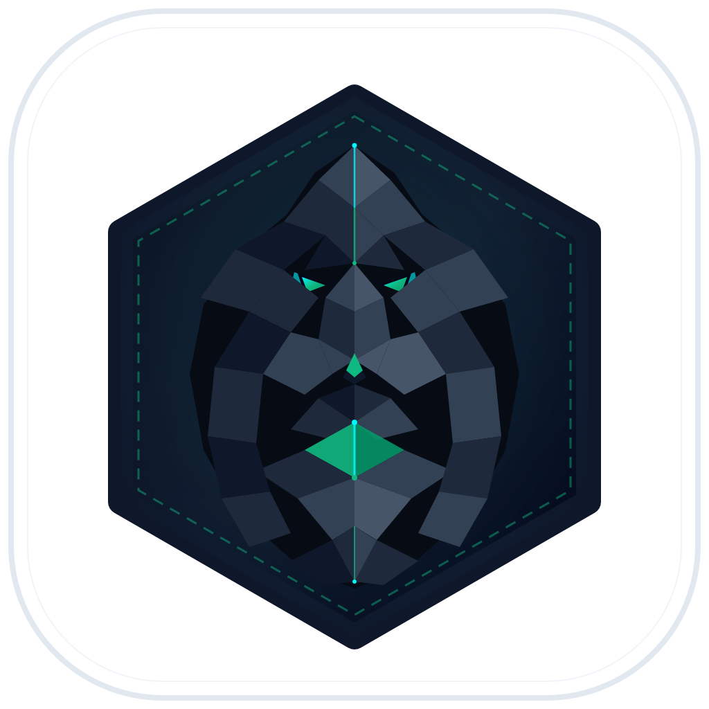
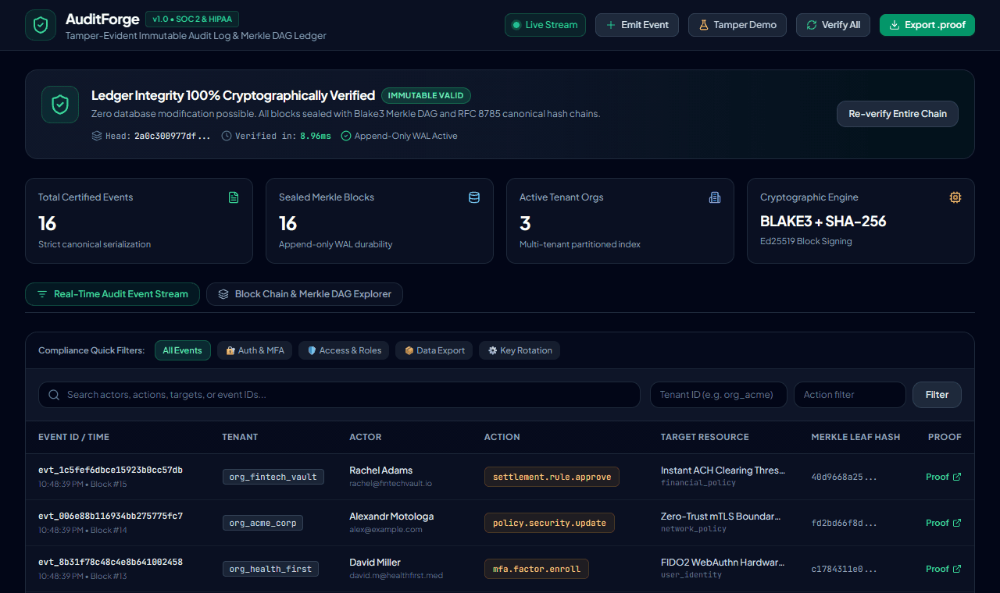
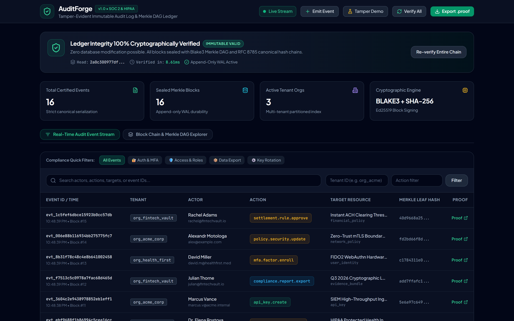
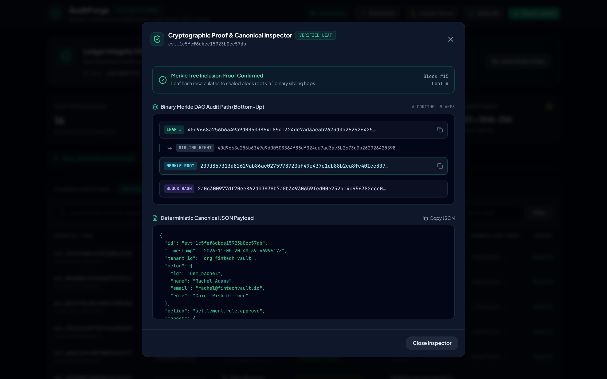
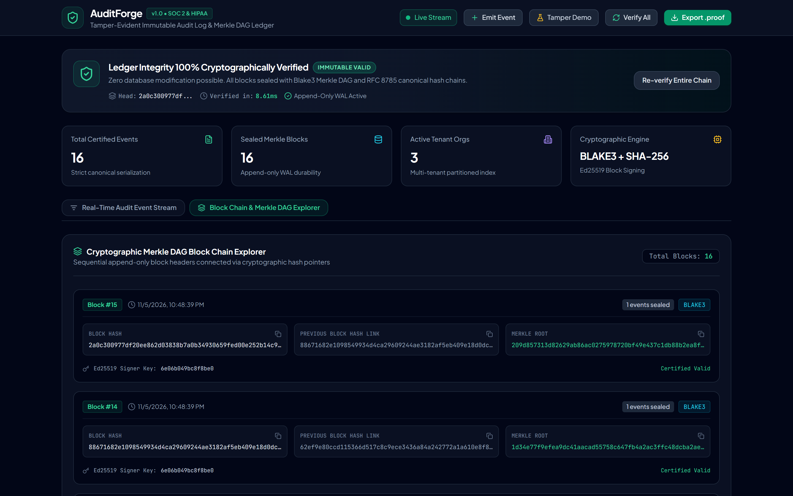
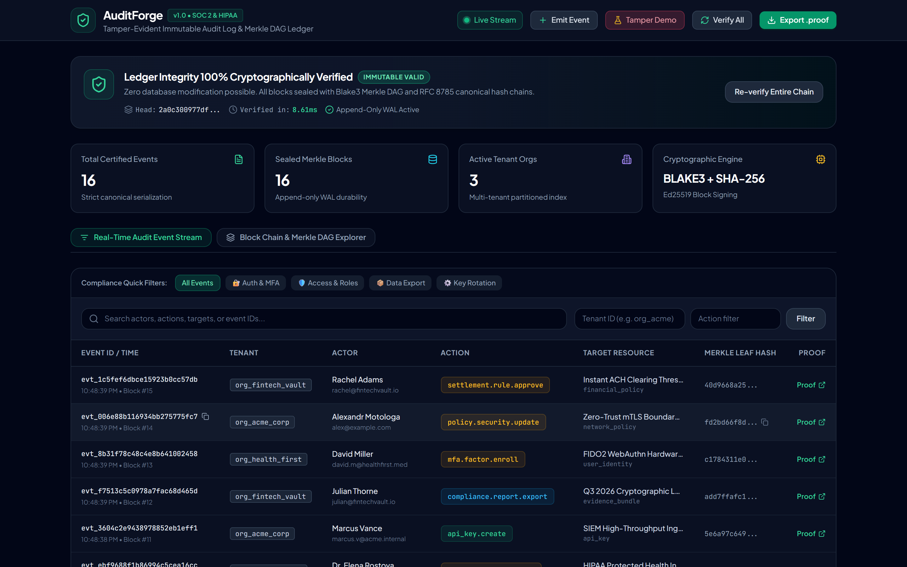
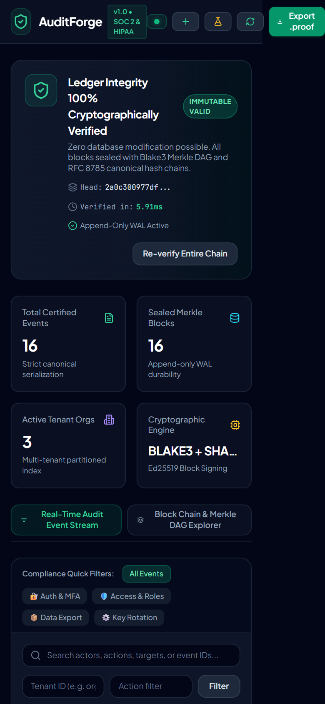

<div align="center">
  
  <h1>AuditForge</h1>
  <p><strong>Tamper-Evident Immutable Audit Log & Cryptographic Compliance Ledger</strong></p>
  <p>Self-hosted append-only ledger engine with Blake3 Merkle DAG verification, RFC 8785 canonical serialization, Ed25519 block sealing, and embedded React 19 compliance cockpit.</p>

  <p>
    <a href="https://github.com/alexandrmotologa/auditforge"></a>
    <a href="https://github.com/alexandrmotologa/auditforge"></a>
    <a href="https://github.com/alexandrmotologa/auditforge"></a>
    <a href="https://github.com/alexandrmotologa/auditforge"></a>
    <a href="https://github.com/alexandrmotologa/auditforge"></a>
    <a href="LICENSE"></a>
  </p>
</div>

---

## Interactive Demo



## Overview

In traditional cloud systems, audit logs live in mutable SQL tables (`UPDATE audit_logs ...`) or expensive third-party SaaS silos. Privileged database administrators, compromised credentials, or malicious actors can alter past rows without leaving a trace.

AuditForge delivers a cryptographic compliance ledger where every event is:
1. Canonicalized to RFC 8785 strict byte order.
2. Formatted as an append-only Write-Ahead Log (WAL) record with CRC32 frame checksums.
3. Grouped into binary Merkle trees using Blake3 or SHA-256.
4. Sealed with Ed25519 signatures and chained to the previous block hash ($H_k = \text{Hash}(H_{k-1} \parallel \text{Root}_k \parallel \dots)$).
5. Indexed into pure-Go SQLite for search and real-time streaming to the embedded React 19 compliance cockpit.

If any byte in historical logs or on-disk WAL records is modified, the cryptographic chain breaks instantly. Auditors can export standalone signed `.proof` bundles and verify the complete history offline with zero network connectivity.

## Screenshots

<div align="center">
  <h3>Real-Time Compliance Cockpit & Dynamic Integrity Shield</h3>
  
  <p><em>Real-time SSE event stream with one-click SOC 2 / HIPAA category filters and on-demand cryptographic verification.</em></p>
</div>

<br />

<div align="center">
  <h3>Cryptographic Merkle Proof Inspector & State Mutation Diff</h3>
  
  <p><em>Binary Merkle audit path step-by-step verification and visual before/after state diff for IAM and configuration changes.</em></p>
</div>

<br />

<div align="center">
  <h3>Block Chain & Merkle DAG Explorer</h3>
  
  <p><em>Cryptographic block headers showing Blake3 roots, previous block hash links, Ed25519 signatures, and event counts.</em></p>
</div>

<br />

<div align="center">
  <h3>Auditor Demonstration Lab: Tamper Detection Alert</h3>
  
  <p><em>Simulating a single-byte database alteration triggers an immediate crimson alert and flags the exact broken block index.</em></p>
</div>

<br />

<div align="center">
  <h3>Mobile Responsive Viewport</h3>
  
  <p><em>Touch-optimized responsive interface on mobile devices.</em></p>
</div>

## Architecture

```
Application Clients (Node.js, Go, Python, cURL, Terraform)
                     |
                     | Ingest: gRPC (:9090) / REST (:8080)
                     v
+--------------------------------------------------------+
|                   auditforge daemon                    |
|                                                        |
|  [ API Auth & Role-Based Access Control (RBAC) ]       |
|               |                                        |
|               v                                        |
|  [ RFC 8785 Canonical JSON Serialization ]             |
|               |                                        |
|               v                                        |
|  [ Lock-Free Batch Ring Buffer (100ms or 500 events) ] |
|               |                                        |
|               v                                        |
|  [ Merkle Tree Leaf Builder (Blake3 / SHA-256) ]       |
|               |                                        |
|               v                                        |
|  [ Block Sealer, Ed25519 Signer & Chain Linker ]       |
|         /                      |             \         |
|        v                       v              v        |
|  [ Append-Only WAL ]   [ SQLite Index ]   [ SIEM Webhooks ]
|  (Raw Binary Ledger)   (Fast Query/Search) (HMAC-SHA256)
|                                                        |
|  [ Real-Time SSE Stream & React 19 Compliance Cockpit] |
+--------------------------------------------------------+
```

## Key Capabilities

* **High-Throughput Dual Ingestion**: Accepts events over gRPC (`:9090`) and HTTP REST (`:8080`) with sub-millisecond write acknowledgement and background accumulation.
* **Strict RFC 8785 Canonical Serialization**: Field order and number representations are normalized before hashing, ensuring byte-identical leaves across platforms.
* **Pure Append-Only Write-Ahead Log (WAL)**: Binary framed storage with `AUDF` magic prefix, uint32 length header, CRC32 checksums, and `ZZ` frame trailers.
* **Cryptographic Block Sealing**: Blocks bind their Merkle root, timestamp, and previous block hash with Ed25519 digital signatures.
* **Multi-Tenant Partitioned Index**: Embedded SQLite database (`modernc.org/sqlite`, zero CGo) enables multi-field filtering by tenant, actor, action, and target.
* **Role-Based Access Control (RBAC)**: Enforces API key permission tiers (`ingest_only`, `auditor_read`, and `admin`).
* **Real-Time SIEM Forwarding**: Asynchronously forwards sealed blocks to external SIEM tools (Datadog, Splunk, Elastic) signed with HMAC-SHA256 (`X-AuditForge-Signature`).
* **External Timestamp Notary (RFC 3161)**: Anchors head block hashes against trusted external timestamp authorities.
* **WAL Segment Rotation**: Compresses inactive segments into cold-storage `.wal.gz` files accompanied by cryptographic manifests.
* **Zero-Dependency Offline Verifier**: Standalone CLI binary (`auditverify`) allows external auditors to inspect `.proof` bundles without access to the server or database.

## Quick Start

### 1. Build Binaries

```bash
# Clone the repository
git clone https://github.com/alexandrmotologa/auditforge.git
cd auditforge

# Build daemon and offline verifier CLI
go build -o bin/auditforge.exe ./cmd/auditforge
go build -o bin/auditverify.exe ./cmd/auditverify
```

### 2. Start the Server

```bash
./bin/auditforge.exe serve --config config.yaml
```

The daemon starts:
* HTTP REST API & Web UI: `http://localhost:8080/ui/`
* gRPC Ingestion Service: `localhost:9090`

### 3. Emit an Audit Event

```bash
curl -X POST http://localhost:8080/api/v1/events?sync=true \
  -H "Content-Type: application/json" \
  -H "X-API-Key: default-dev-key" \
  -d '{
    "tenant_id": "org_acme_corp",
    "actor": {
      "id": "usr_alexander",
      "name": "Alexandr Motologa",
      "email": "alex@example.com",
      "role": "Security Architect"
    },
    "action": "role.permission.grant",
    "target": {
      "id": "role_auditor",
      "type": "iam_role",
      "name": "External Auditor Role"
    },
    "metadata": {
      "ip_address": "192.168.1.100",
      "previous_state": { "permissions": ["read:summary"] },
      "new_state": { "permissions": ["read:summary", "export:proof"] }
    }
  }'
```

Response:
```json
{
  "status": "sealed",
  "event_id": "evt_e7ec967878df7520ad16b45d",
  "leaf_hash": "2f10b89...",
  "block_index": 0,
  "block_hash": "b8a9a314...",
  "received_at": "2026-11-05T20:48:33Z"
}
```

### 4. Client SDKs

#### Go Client (`sdk/go`)

```go
package main

import (
	"context"
	auditforge "github.com/alexandrmotologa/auditforge/sdk/go"
)

func main() {
	client := auditforge.NewClient(auditforge.Config{
		Endpoint: "http://localhost:8080",
		APIKey:   "default-dev-key",
		TenantID: "org_acme_corp",
	})
	defer client.Close()

	// Non-blocking asynchronous emit (buffered in memory)
	client.Emit(&auditforge.AuditEvent{
		Action: "database.credential.rotate",
		Actor:  auditforge.Actor{ID: "usr_sarah", Name: "Sarah Chen"},
		Target: auditforge.Target{ID: "db_vault", Type: "vault_secret"},
	})
}
```

#### TypeScript Client (`sdk/ts`)

```typescript
import { AuditForgeClient } from '@auditforge/client';

const client = new AuditForgeClient({
  endpoint: 'http://localhost:8080',
  apiKey: 'default-dev-key',
  tenantId: 'org_acme_corp',
});

// Fire-and-forget background queue with retry
client.emit({
  action: 'patient.record.access',
  actor: { id: 'usr_elena', name: 'Dr. Elena Rostova' },
  target: { id: 'rec_pt_8839210', type: 'phi_record' },
});
```

### 5. Offline Cryptographic Verification

Export an auditor proof bundle:
```bash
./bin/auditforge.exe export-proof --from 0 --to 15 --out proof_bundle.proof
```

Verify with zero dependencies:
```bash
./bin/auditverify.exe verify proof_bundle.proof
```

Output:
```text
==> Loading cryptographic proof package: proof_bundle.proof
[OK] Manifest parsed successfully (Version: 1.0, Algorithm: blake3)
[OK] Scope: 16 blocks (Blocks #0 to #15), 16 total events
[OK] Manifest Ed25519 digital signature: VALID (Key ID: 6e06b049bc8f8be0)
==> Verifying Merkle inclusion proofs for all encapsulated events...
[OK] All 16 event leaves and Merkle audit paths: 100% VALID
==> Verifying block headers and cryptographic hash chain...
[OK] All 16 cryptographic block headers & chain links: UNBROKEN
--------------------------------------------------------------------------------
RESULT: LEDGER INTEGRITY CONFIRMED (0 TAMPER DETECTED in 8.75ms)
--------------------------------------------------------------------------------
```

Generate a standalone HTML compliance certificate report:
```bash
./bin/auditverify.exe report proof_bundle.proof --out compliance_report.html
```

## Security Invariants

* **Merkle Leaf Domain Separation**: Leaves use prefix `0x00` and interior nodes use prefix `0x01` (RFC 6962) to prevent second-preimage collision attacks.
* **Deterministic Numbers in JSON**: All JSON numbers retain arbitrary precision without float64 IEEE rounding.
* **Strict WAL Recovery**: Any corrupt or torn write at the end of the WAL file is halted with CRC32 mismatch detection before it can contaminate the index.

## License

MIT License. Copyright (c) 2026 Alexandr Motologa.
